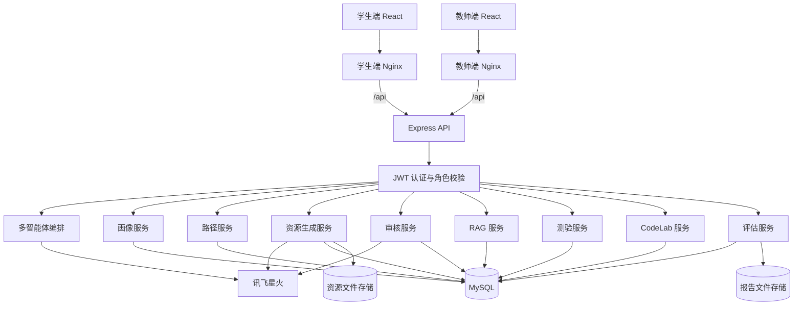
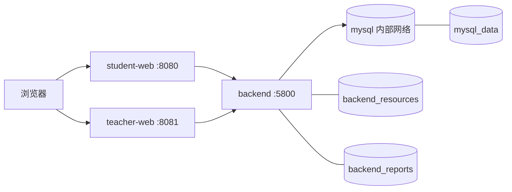

# 系统架构说明

## 总体架构

## 四条核心流

1. **请求流**：浏览器访问两套 Nginx；同源 `/api` 转发到 Express；JWT 中间件读取身份，学生接口以 `studentId` 隔离，教师接口再校验角色和班级管理关系。
2. **数据流**：画像、掌握度、错误模式、路径版本、题目、提交、资源版本、检索运行、引用和报告元数据写入 MySQL；接口返回的是当前身份可见的聚合结果。
3. **Agent 调用流**：编排器构造统一上下文，按任务调用 Agent 并记录状态、耗时和来源；结构或模型输出失败时进入确定性回退，不能直接写入未经校验的路径或资源。
4. **文件流**：PPTX/PDF 先写同一存储根下临时文件，检查大小/文件头等条件后原子重命名，保存 SHA-256、MIME、大小和相对路径；下载时再次执行所有权/教师关系与根目录限制。

## 权限边界

学生端只以 JWT 中的学生身份访问画像、路径、资源、评估与引用；请求体中的伪造学生 ID 不作为权限依据。教师角色读取数据库中的当前角色，并通过 `teacher_classes` 与 `teacher_class_students` 检查管理关系；管理员是代码支持的更高权限角色。前端不持有数据库和 AI 密钥。

## Docker 结构与持久化

MySQL 只暴露在 Compose 内部 `database` 网络；两套前端和后端位于 `web` 网络。后端等待 MySQL 健康，前端等待后端健康。三个命名卷分别保存数据库、资源文件和报告文件；知识库原始 Markdown 随后端镜像分发，导入后的数据在 MySQL。

> Dockerfile 和 Compose 已完成静态设计、安全检查和配置解析；由于当前机器缺少 Docker Engine，真实镜像构建、四容器启动、卷重启持久化仍待补充验收。
