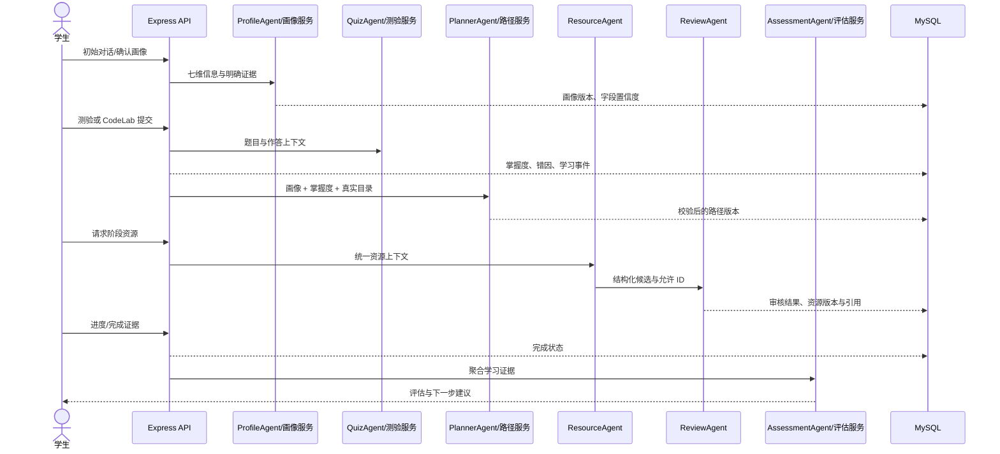

# 多智能体设计

多智能体不是多个聊天机器人。八个后端角色围绕同一学生身份、画像、题库、路径和活动证据协作；关键更新由 Schema、事务和确定性规则兜底，AI 失败不能破坏主学习链路。

| Agent | 输入与依赖 | 输出 | 触发位置 | 失败回退 | 不负责 |
| --- | --- | --- | --- | --- | --- |
| ProfileAgent | 问题、课程/知识点、历史、画像或活动 | 画像摘要/更新建议 | 聊天、资源生成、画像更新 | 课程/知识点/薄弱点模板；画像对话只保留明确表达 | 不直接绕过画像版本服务写库 |
| ResourceAgent | 画像摘要、主题、难度、路径上下文 | Markdown 或结构化资源候选 | 聊天代码示例、资源生成 | 完整 Markdown 模板；五类资源使用类型专用确定性构建器 | 不审批、不决定完成证据 |
| ReviewAgent | 候选内容、上下文、允许的题目/练习 ID | 审核摘要或结构化审核 | 聊天、资源入库前 | 确定性审核：上下文、ID、结构、重复、安全、难度、引用 | 不替代题库判分与权限校验 |
| PlannerAgent | 画像、掌握度、真实题目/练习目录 | 路径建议或严格 JSON 路径 | 资源流程、`/api/path/generate` | 按掌握度和目录确定性规划 | 不创造题目/练习 ID，不越过 Schema |
| QuizAgent | 学科、知识点、难度、开放题评分点 | 题目、提示或同类题 | 自适应题、提示、同类题 | 题目/提示模板，正式 `quiz_pack` 只引用真实题库 | 不信任前端分数，不直接更新掌握度 |
| FeedbackAgent | 学生答案、标准答案、解析、评分点 | 错因、建议、下一步行动 | 错题分析 | 基于答案对照与评分点的结构化文本 | 不代替确定性掌握度计算 |
| TutorAgent | 学生问题、历史、课程和检索上下文 | 循序渐进讲解 | 聊天答疑 | “定义—过程—边界”模板 | 不写路径、题库或画像版本 |
| AssessmentAgent | 学习结果、答题和阶段表现 | 阶段总结、风险与建议文本 | 评估编排 | 基于现有得分/活动的总结模板 | 不生成虚构指标；正式报告由确定性快照服务构建 |

五类结构化资源实际由 `multimodalResourceAgent` 和 `multimodalReviewAgent` 执行：前者在 AI 未启用或输出不合法时返回类型专用确定性内容，后者把规则审核作为不可跳过的底线，再可选叠加模型审核。

## 协同时序

## 可靠性边界

Agent 的自然语言输出不是系统事实。路径必须通过字段白名单、依赖无环、知识点及题目/练习 ID 校验；资源必须通过类型 Schema、规则审核和引用验证；测验分数由后端重算；`generated` 代码案例完成后标为 `completed_unverified`，不能成为路径自动完成证据。
