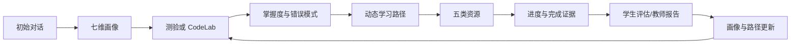

# 个性化学习闭环

## 七维画像

| 字段 | 真实含义 | 例证来源 |
| --- | --- | --- |
| `majorAndGrade` | `major` 与 `grade`，专业和年级 | 学生对话或主动编辑 |
| `currentCourse` | 当前学习课程 | 对话确认 |
| `priorKnowledge` | 已有基础数组 | 学生明确表达 |
| `learningGoals` | 学习目标数组 | 学生确认 |
| `explanationPreference` | 偏好的讲解方式 | 对话/主动修改 |
| `resourcePreferences` | 偏好的资源类型 | 对话/主动修改 |
| `paceAndTimeBudget` | 节奏偏好与每周分钟数 | 明确时间表达；上限 10080 分钟 |

画像完整度按七个字段是否齐全确定。字段元数据保存 `confidence`、`evidence` 和 `source`；对话提取不得用低置信度覆盖既有高置信度字段，学生主动编辑并确认时置信度为 1。画像确认或活动更新写入递增版本，保留变更原因、证据和来源；接口最多返回最近 30 个历史版本。

## 行为证据与更新

测验提交由后端读取真实题目、重算对错与得分；随后更新 `student_knowledge_mastery`、`student_error_patterns` 和画像版本。错误模式包含出现次数、置信度与最近证据。路径服务以当前画像、掌握度、题库与 CodeLab 目录构建候选，经严格 Schema 后保存语义指纹；语义未变化不制造新版本。

路径阶段的完成条件只能是 `quiz`、`codelab` 或 `resource`。CodeLab 只接受 `path_completion_eligible=1` 且成功的真实练习提交；资源完成要求已打开/下载、进度 100%、累计至少 30 秒。生成但未验证的代码案例只能进入 `completed_unverified`。

## 个性化如何被证明

不以“AI 说它个性化”为证据，而以可观察差异证明：同一知识点在不同画像、掌握度、错误模式、阶段目标、时间预算和资源偏好下，其 `context_fingerprint`、生成依据、目标学习者摘要、难度分布、阶段绑定和后续路径可以不同；每次资源版本保留内容指纹、生成来源、Prompt 版本、审核记录与引用。
