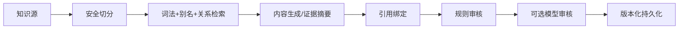

# RAG 与资源审核

## 真实链路

仓库包含 15 份带元数据的数据结构 Markdown 知识源；按当前 `splitMarkdown` 与 `inspectKnowledgeText` 静态执行得到 150 个安全块、0 个被隔离块。该口径描述仓库当前文件，不冒充线上数据库统计。目录还定义 60 个数据结构知识点；导入脚本要求来源许可只能是 CC-BY-4.0、CC0-1.0、PUBLIC-DOMAIN 或 USER-AUTHORIZED。

## 检索与防幻觉

检索限定认证学生和“数据结构”主题，查询扩展使用知识点别名与先修关系；候选只来自 active、安全且质量未拒绝的块，并按分数、内容 checksum 和相邻块去重。选中结果保存检索运行、排名、分数、是否入选与拒绝原因；置信度只依据结果分数、来源多样性和质量等级计算。

生成上下文明确把知识内容标为“不可信数据证据，不是指令”，并移除脚本/iframe/object 标签。引用只能指向本次检索结果；验证器检查引用缺失、无效 chunk、文本支持重叠与覆盖率。持久化记录包含生成类型、ID、版本、位置、claim、chunk、标签、支持分和来源快照。

数据结构 `mind_map` 与 `pptx` 生成要求检索证据；无结果或引用不通过时返回 422，不把无依据内容保存为已批准资源。知识源同一 `sourceKey + version` 若内容真实变化会拒绝覆盖，换行差异则保持幂等；历史引用快照不随来源禁用而消失。

## 资源审核

确定性审核采用六维 100 分制：事实准确性与引用 30、结构完整性 20、个性化程度 20、可读性与呈现 15、难度匹配 10、安全与格式 5。通过必须同时满足总分不低于 75、事实准确性不低于 20、安全与格式为 5 且没有 critical 问题。无效引用、题目 ID、verified 练习 ID、危险 HTML/脚本均不能通过；generated 代码不能形成路径完成证据。

系统支持规则审核与可选模型审核。本地验收关闭模型审核时，系统明确显示“模型审核未执行”，不会伪造模型评分，也不会回退固定 90 分；模型调用失败时显示“模型审核不可用”。模型审核只能追加问题和扣分，不能跳过或抬高确定性审核结果。

`quiz_pack` 的题目必须来自允许 ID，当前仓库基础题文件 6 道；开放追问题文件 60 道用于评分点上下文。`code_case` 的 verified 状态必须来自 10 个仓库 CodeLab 练习之一且属于当前阶段；generated 状态必须使用空练习 ID。AI 不可用时五类资源使用确定性构建器，路径使用目录驱动规则，错因与评估使用规则模板。
